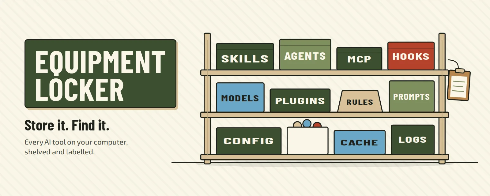
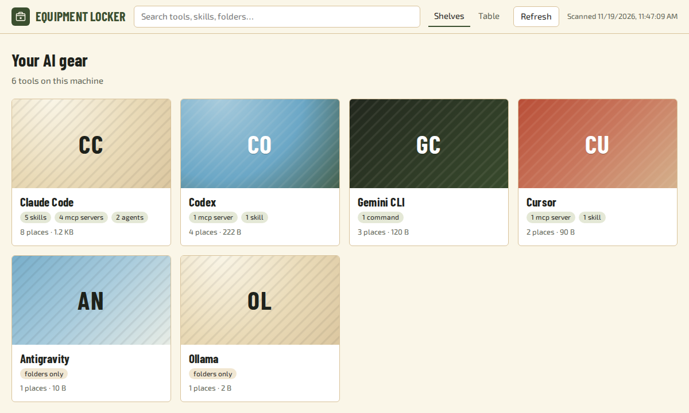
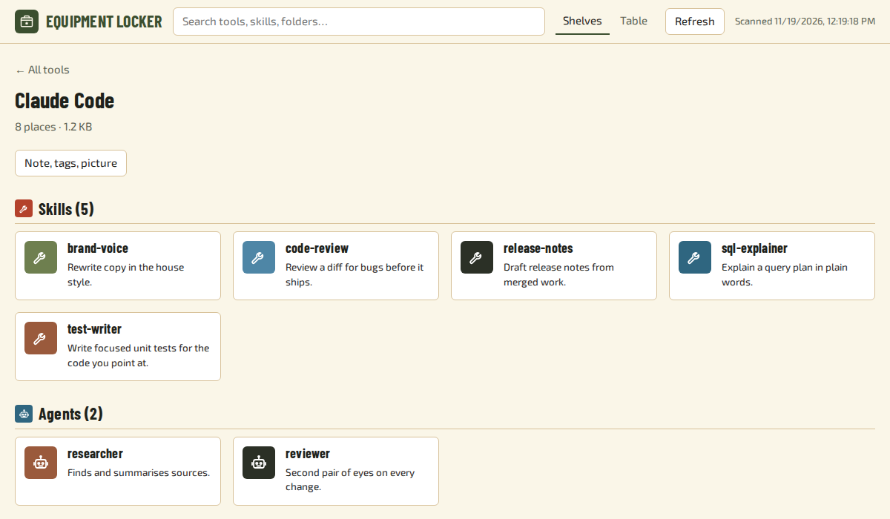

<p align="center"></p>

<h1 align="center">Equipment Locker</h1>
<p align="center"><b>Store it. Find it.</b> A display cabinet for your AI tools.</p>

Equipment Locker takes stock of the AI tools on your computer (Claude Code, Claude Desktop, Codex, ChatGPT,
Antigravity, Gemini CLI, Cursor, Copilot, local models and more) and shows what you have and where it lives:
skills, agents, commands, MCP servers, plugins, models and the folders behind them. Add a note, a tag or a
picture to anything so you remember why it is there.

It is a **catalogue, not an editor**. It never changes your tool files and never reads their contents. It records
names, paths, sizes and dates, plus the one-line description a skill or plugin already declares about itself.

<p align="center"></p>

## Quick start
Python 3.11 or newer; nothing else to install.

```bash
git clone https://github.com/JR91387/ai_equipment_locker && cd ai_equipment_locker
pipx install .                 # adds the equipment-locker command (or skip it: PYTHONPATH=src python3 -m equipment_locker)
equipment-locker serve         # opens on http://127.0.0.1:8765
```

`serve` takes stock when it starts, again every 6 hours while it runs, and whenever you press **Refresh**.
Prefer the terminal? `equipment-locker scan` fills the same catalogue and prints a summary.

The catalogue is one SQLite file: `~/.local/share/equipment-locker/locker.db` on Linux,
`~/Library/Application Support/equipment-locker/locker.db` on macOS, `%LOCALAPPDATA%\equipment-locker\locker.db`
on Windows. `--help` and every scan summary show the exact path.

<p align="center"></p>

## What you get
- **Shelves** of tools, each with counts of its skills, agents, MCP servers and plugins.
- **One click** into a tool: every item with its description, every folder with its size.
- **Search** that ignores case and punctuation: `code review`, `Code-Review` and `code_review` all match.
- **Your labels**: notes (with history), tags, favourites and pictures, kept in one SQLite file.
- **Pinned folders** for anything the built-in list does not know about.
- **Recognisable tools**: known tools show their own icon; the rest get one of ten palette gradients.
- **Kinds at a glance**: a wrench for skills, a robot for agents, a plug for MCP servers, each on its own colour.

## Ask it from an LLM (MCP)
Equipment Locker includes a small MCP server, so Claude, a local model or any MCP client can look things up in
your catalogue ("do I have a skill for code review?", "which MCP servers does Cursor use?").

```bash
# Claude Code
claude mcp add equipment-locker -- equipment-locker mcp
# without pipx:
claude mcp add equipment-locker -e PYTHONPATH=/path/to/equipment-locker/src -- python3 -m equipment_locker mcp
```

```json
{ "mcpServers": { "equipment-locker": {
    "command": "python3", "args": ["-m", "equipment_locker", "mcp"],
    "env": { "PYTHONPATH": "/path/to/equipment-locker/src" } } } }
```

| Tool | What it does |
|---|---|
| `search` | Find anything; case and punctuation do not matter |
| `list_tools` | Every tool with counts, and when the catalogue was last scanned |
| `tool_detail` | One tool's items and folders |
| `item_detail` | One thing in full, with your note and tags |
| `recent_changes` | What appeared, changed or disappeared lately |
| `add_tag`, `remove_tag`, `set_note` | Label things; earlier notes are kept |

Add `--read-only` to hide the three labelling tools. The server only serves the catalogue; it never reads tool files.

## Privacy and safety
- Everything stays on your computer: one SQLite file, a page served only to `127.0.0.1`.
- Read-only: files are listed, never opened, except the first 8 KB of a skill or agent file (for its
  name and description), plugin manifests, and MCP config files (for server **names** only, never their settings).
- Login files are only checked for existence. Symbolic links are never followed.
- Gentle on disks: a capped number of folder entries per run, unchanged folders are not re-read, low priority.

## Learn more
[Getting started](docs/wiki/Getting-Started.md) · [What it catalogs](docs/wiki/What-It-Catalogs.md) ·
[Use with an LLM](docs/wiki/Use-with-an-LLM.md) ·
[Privacy and safety](docs/wiki/Privacy-and-Safety.md) · [Platforms](docs/wiki/Platforms.md) ·
[Run on a schedule](docs/wiki/Run-On-A-Schedule.md) · [View from another machine](docs/wiki/View-From-Another-Machine.md) ·
[FAQ](docs/wiki/FAQ.md)

<p align="center"></p>

## License
MIT. See `LICENSE`. Equipment Locker was built with AI assistance (Claude). Product names and logos are
trademarks of their owners and are shown only to identify the tools; no endorsement is implied (see
`src/equipment_locker/web/icons/tools/SOURCES.md`). Bundled fonts (Barlow Condensed, Exo 2) are under the SIL Open Font License; see
`src/equipment_locker/web/fonts/`.
