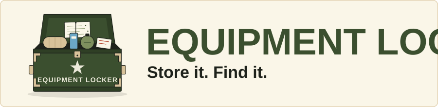

# Equipment Locker
**Store it. Find it.** A display cabinet for the AI tools on your computer.

It answers one question at a glance: *what do I have, and where is it?* Tools sit on shelves; open one to see its
skills, agents, MCP servers, plugins and folders. Add notes, tags, favourites and pictures. Nothing it finds is ever
changed.

- [Getting started](Getting-Started.md)
- [What it catalogs](What-It-Catalogs.md)
- [Use with an LLM (MCP)](Use-with-an-LLM.md)
- [Privacy and safety](Privacy-and-Safety.md)
- [Platforms](Platforms.md)
- [FAQ](FAQ.md)
